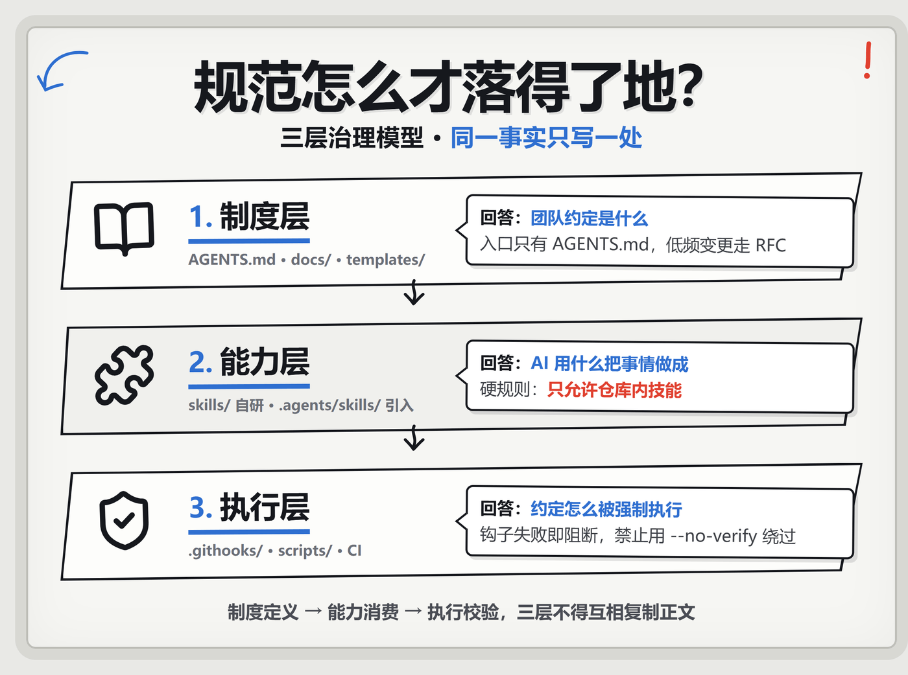
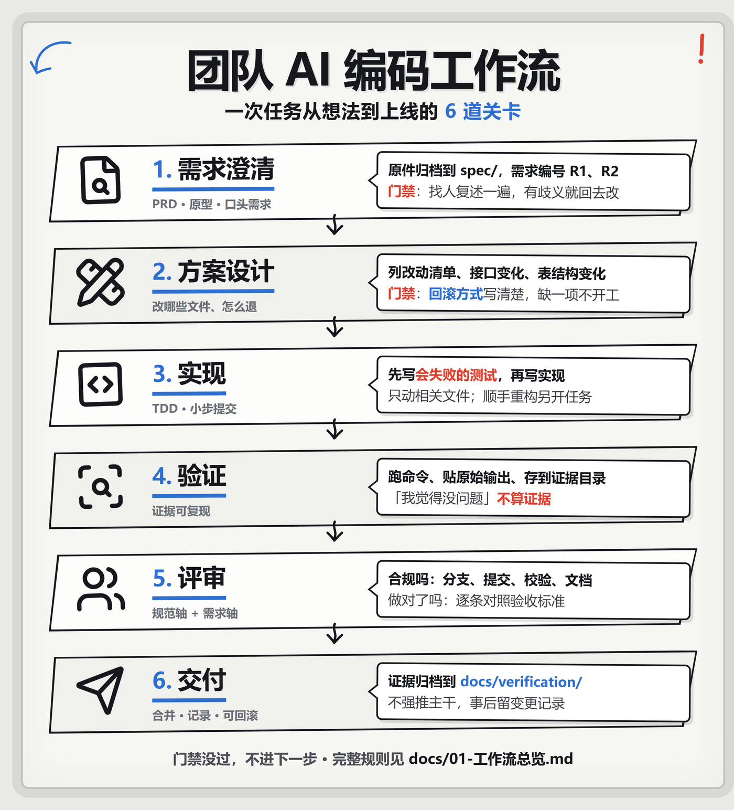
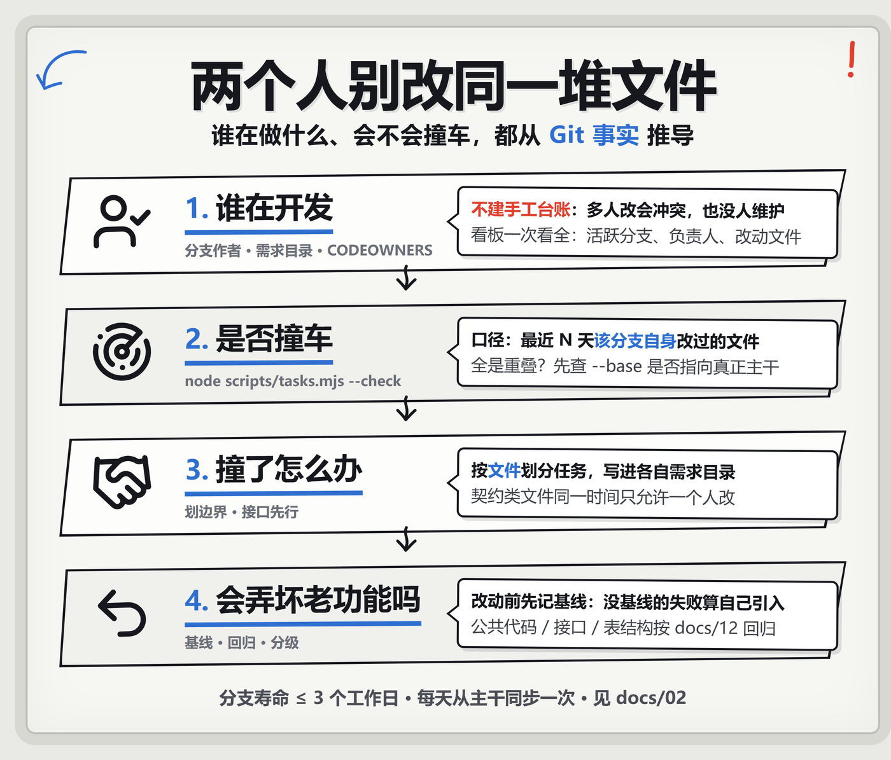
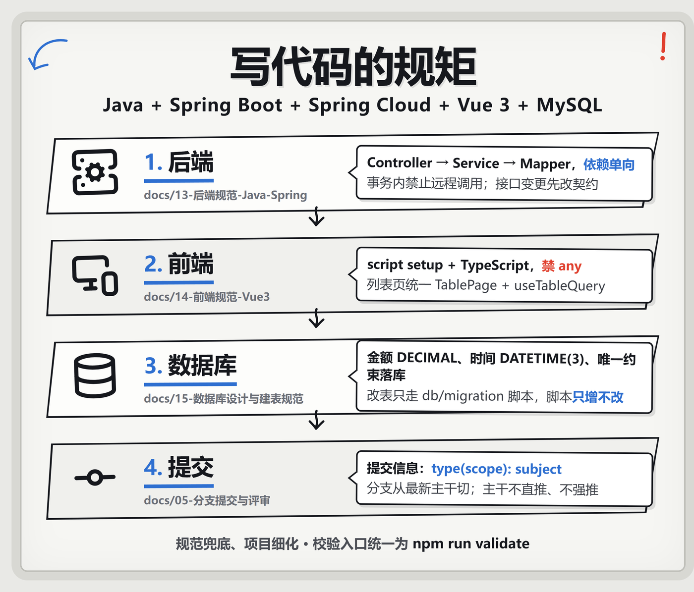
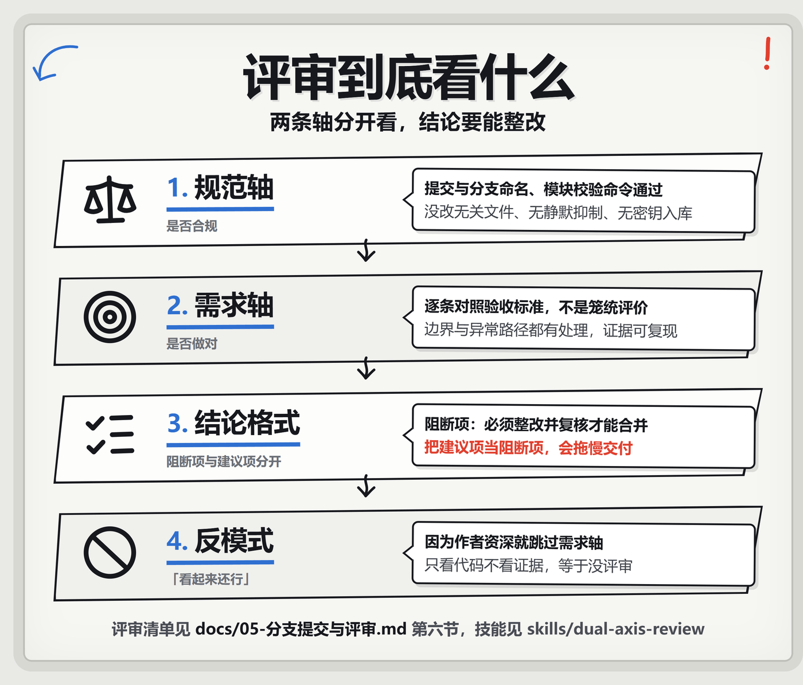
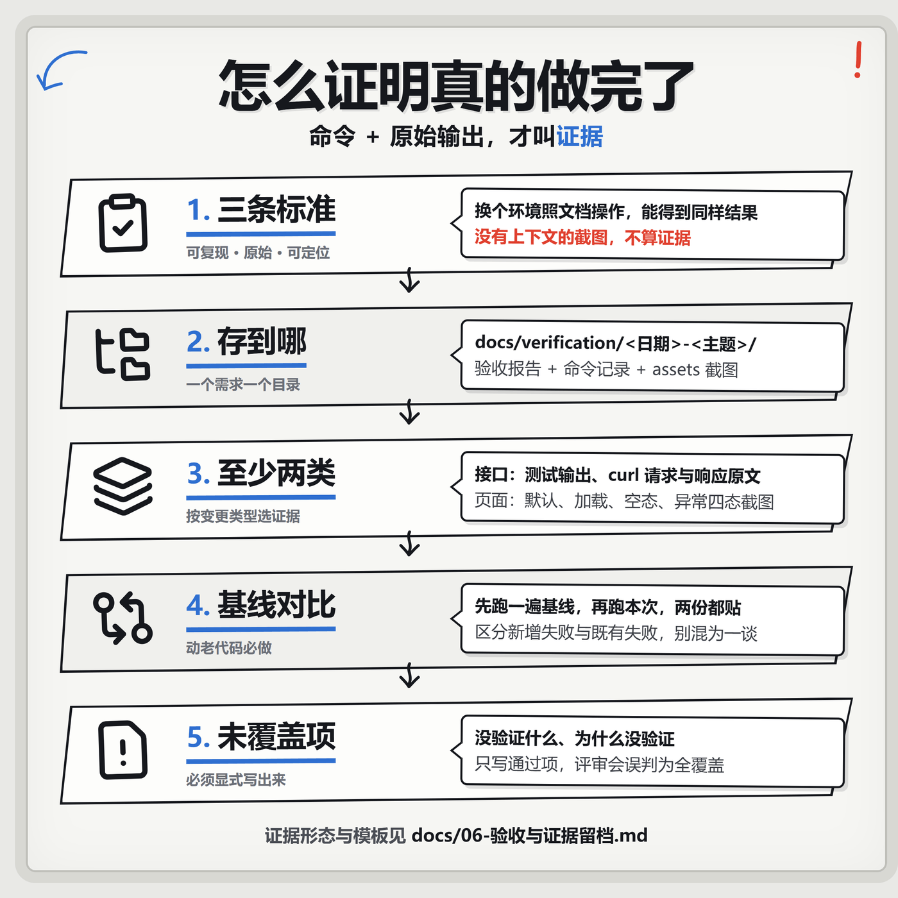
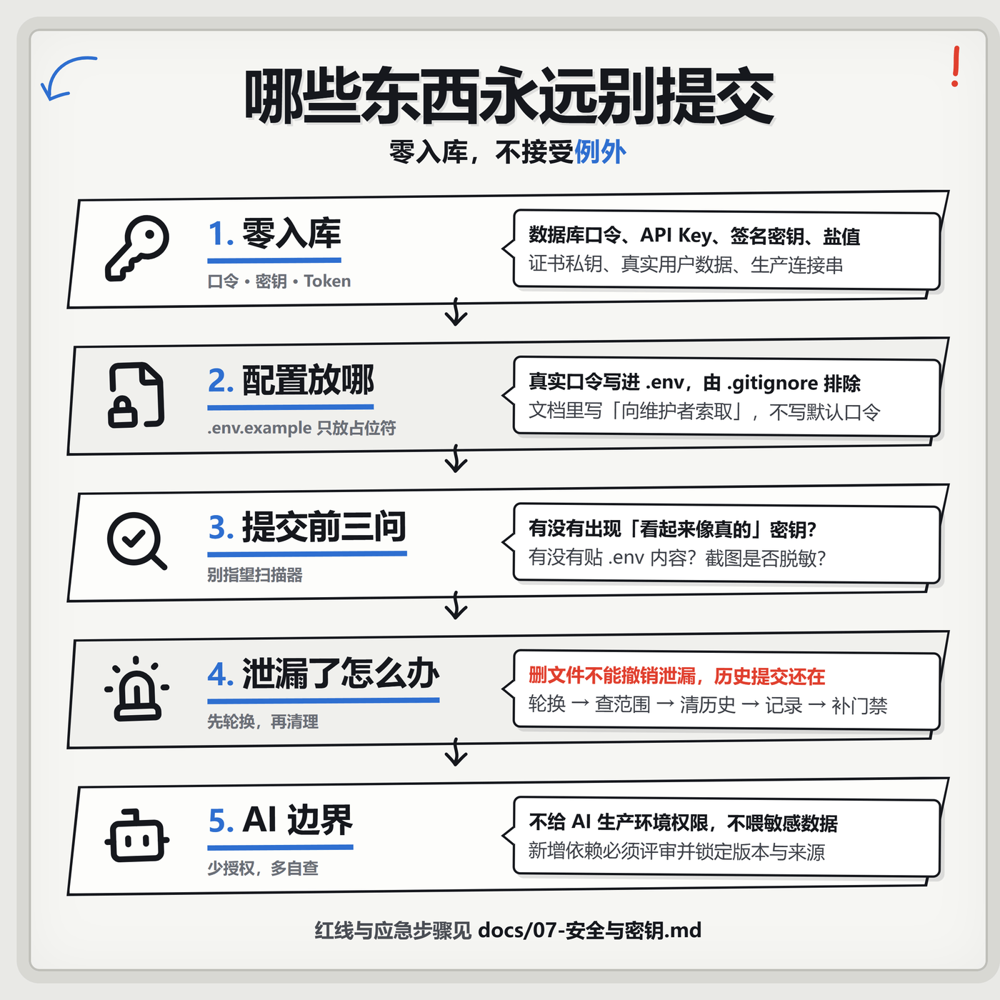
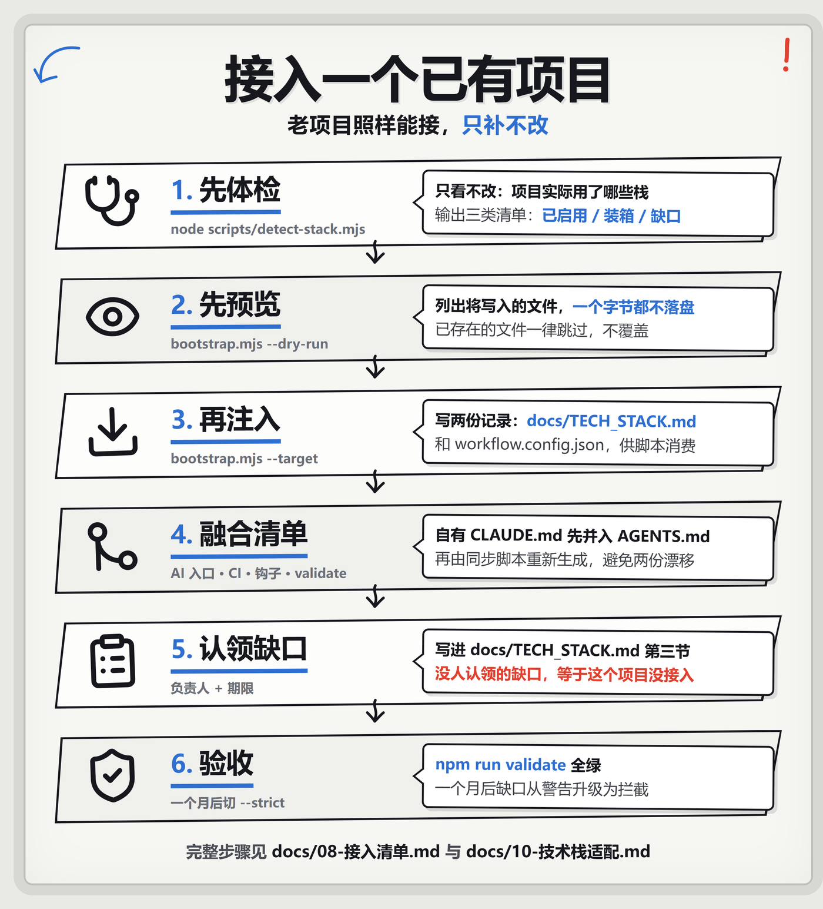
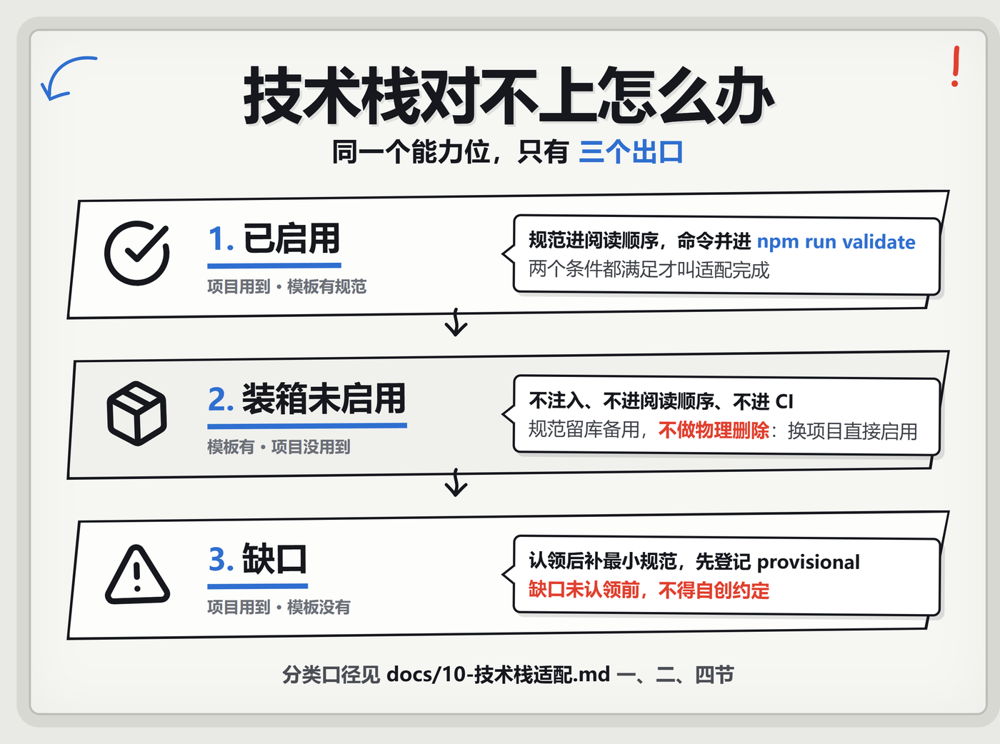
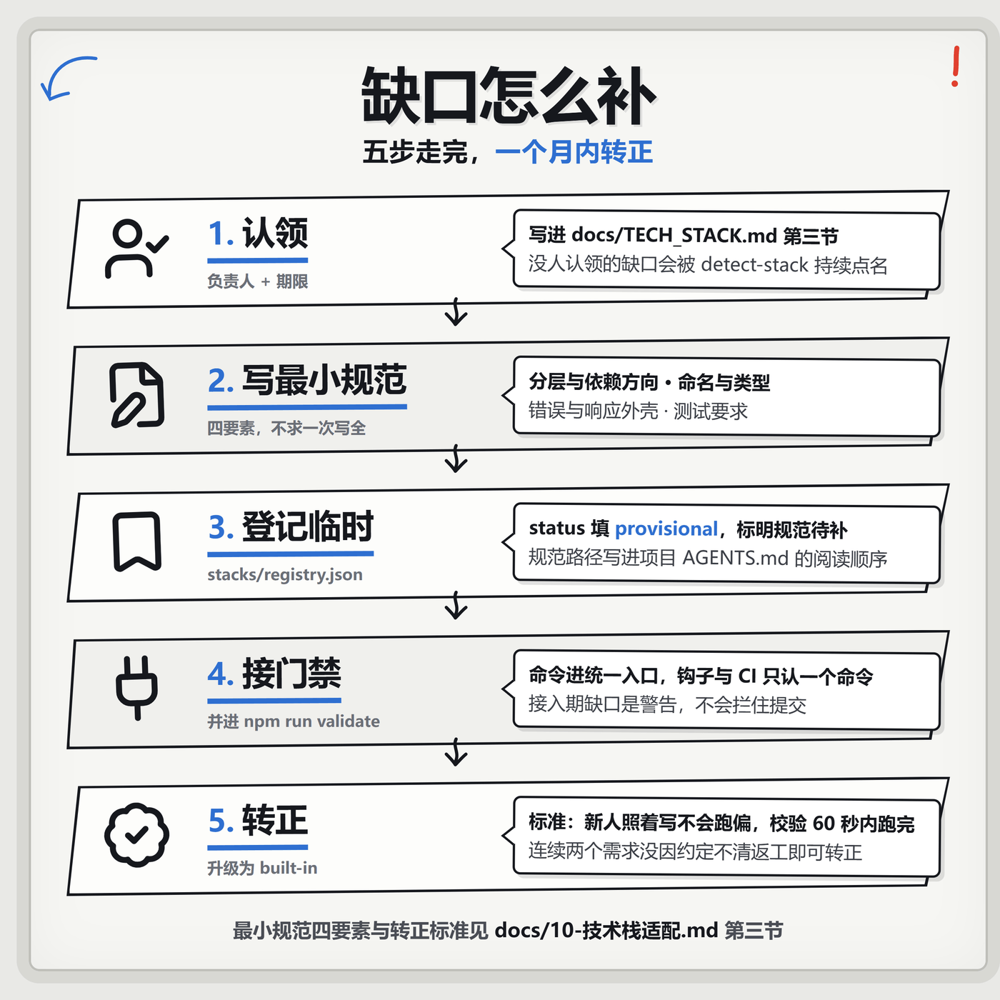

# hqc-ai-coding-work-flow

面向团队协作的 AI 编码工作流模板：把「需求 → 设计 → 实现 → 验证 → 评审 → 交付」固化成可执行的规范、技能和脚本。

本仓库同时扮演两个角色：

- **方法论**：`docs/` 说明为什么这么约定，以及团队怎么落地。
- **工程骨架**：`skills/`、`scripts/`、`.githooks/`、`templates/` 可以直接复制或一键注入到任意业务项目。
  托管平台不绑定：CI、`CODEOWNERS`、合并请求模板同时提供 GitHub 与 GitLab 两套，接入时自动探测，见 [接入清单](docs/08-接入清单.md) 步骤 1。

默认技术栈为 **Java 17 + Spring Boot 3 + Spring Cloud + MySQL 8 + Vue 3（Vite / uni-app）**，对应规范见
[后端规范](docs/13-后端规范-Java-Spring.md)、[前端规范](docs/14-前端规范-Vue3.md)、[数据库设计与建表规范](docs/15-数据库设计与建表规范.md)；
流程本身与语言无关：接入项目时自动探测实际技术栈，分「已启用 / 装箱未启用 / 缺口」三类处理，
项目有、模板没有的栈走补规范流程，模板有、项目没有的栈装箱留用，见 [技术栈适配](docs/10-技术栈适配.md)。

---

## 一、它解决什么问题

| 典型问题 | 本模板的应对 |
| --- | --- |
| 每个人用 AI 的方式不同，产出质量方差大 | 六阶段流水线 + 阶段门禁，见 [工作流总览](docs/01-工作流总览.md) |
| 需求与决策散落在聊天记录里，事后无法追溯 | `spec/` 按日期留档需求、`MEMORY.md` 记录决策、`docs/verification/` 留存验收证据 |
| AI 说「改好了」，但没人真正验证过 | 强制「先跑命令、贴原始输出，再下结论」，见 [验收与证据留档](docs/06-验收与证据留档.md) |
| 外部技能版本漂移，昨天能跑今天不能跑 | `skills-lock.json` 锁定来源与哈希，见 [技能体系](docs/03-技能体系.md) |
| 数据库口令、API Key 被写进文档并提交 | 密钥零入库 + 提交前扫描，见 [安全与密钥](docs/07-安全与密钥.md) |
| 规范只写在文档里，没人执行 | `.githooks/` 与平台 CI（`.github/workflows/`、`.gitlab-ci.yml`）把规范变成「失败即阻断」的检查 |
| 公司内网用 GitLab，模板却只带 GitHub 的 CI 与 PR 模板 | GitHub / GitLab / Gitee 三套产物都在 [templates/platform](templates/platform/README.md)，接入时自动探测；探测错了用 `--platform` 纠正 |
| 项目用不到某个 AI 工具，却被迫留下它的配置目录 | `workflow.config.json` 的 `aiEntries` 决定生成哪些入口，去掉谁就不生成谁（例如不用 Copilot 就没有 `.github/`） |
| 各人用自己机器上的私有技能，换台机器就复现不了 | 只允许仓库内技能（`skills/` 与 `.agents/skills/`），`scripts/check-skills.mjs` 负责拦住越界来源，见 [技能体系](docs/03-技能体系.md) 第五节 |
| 新人不知道从哪读起 | [快速开始](docs/00-快速开始.md) + [接入清单](docs/08-接入清单.md) |
| 已有项目接入时被模板冲掉原有约定 | 只补不改：先体检、再按融合清单逐项合并，见 [技术栈适配](docs/10-技术栈适配.md) 第二节 |
| 项目用的技术栈模板里没有规范 | 探测报缺口 → 认领 → 写最小规范 → 登记 `provisional` → 限期转正，见 [技术栈适配](docs/10-技术栈适配.md) 第三节 |
| 模板规范里有一堆项目用不到的技术栈 | 装箱不启用：不注入、不进阅读顺序、不进 CI，规范留库备用 |

## 二、三层治理模型

| 层 | 回答的问题 | 载体 | 变更方式 |
| --- | --- | --- | --- |
| 制度层 | 团队约定是什么 | `AGENTS.md`、`docs/`、`templates/` | 低频，走 RFC 讨论 |
| 能力层 | AI 用什么把事情做成 | `skills/`（自研）、`.agents/skills/`（引入） | 中频，走技能共建流程 |
| 执行层 | 约定怎么被强制执行 | `.githooks/`、`scripts/`、平台 CI（`.github/workflows/` 或 `.gitlab-ci.yml`） | 中频，走 PR / MR 评审 |

核心原则：**同一事实只写一处**。制度层负责定义，能力层负责消费，执行层负责校验，三者不得互相复制正文内容，只能引用。



## 三、六阶段流水线

```text
① 需求澄清  →  ② 方案设计  →  ③ 实现    →  ④ 验证    →  ⑤ 评审    →  ⑥ 交付
   产物 spec     产物 计划       产物 代码    产物 证据    产物 结论    产物 记录
   门禁 复述     门禁 评审       门禁 测试    门禁 复现    门禁 整改    门禁 回滚
```

每阶段的输入、输出、门禁，以及「什么情况下才算完成」，见 [工作流总览](docs/01-工作流总览.md)。



## 四、多人并行怎么不打架

团队规模一大，最容易失控的是四件事，模板分别给了可执行的答案：



- **谁在开发**：不维护手工台账，直接从 Git 事实推导——活跃分支、分支作者、`CODEOWNERS`、各自的需求目录。
- **会不会撞车**：`node scripts/tasks.mjs --check` 按「最近 N 天该分支自身改过的文件」比对重叠，重叠即预警。
- **撞了怎么办**：按文件而不是按人划分任务，契约类文件同一时间只允许一个人改；接口先行，双方按契约并行开发。
- **会不会弄坏老功能**：动手前先跑一次基线，没基线的失败算自己引入；公共代码、接口与表结构按影响面分级回归。

角色分工、分支寿命与同步节奏见 [团队协作与角色](docs/02-团队协作与角色.md)，影响面判定见 [影响面与回归防护](docs/12-影响面与回归防护.md)。

## 五、写代码的规矩

流程只管「怎么走」，不代替技术规范。默认技术栈的硬性要求都落在 `docs/` 里：



- **后端**：[Java / Spring 规范](docs/13-后端规范-Java-Spring.md)——分层依赖单向、事务内禁止远程调用、接口变更先改契约。
- **前端**：[Vue 3 规范](docs/14-前端规范-Vue3.md)——组合式 API 加 TypeScript、禁用 `any`、列表页统一 `TablePage` 与 `useTableQuery`。
- **数据库**：[数据库设计与建表规范](docs/15-数据库设计与建表规范.md)——金额 `DECIMAL`、时间 `DATETIME(3)`、唯一约束落库，改表只走 `db/migration` 脚本且脚本只增不改。
- **提交**：[分支提交与评审](docs/05-分支提交与评审.md)——提交信息 `type(scope): subject`，分支从最新主干切，主干不直推、不强推。

规范兜底、项目细化，校验入口统一为 `npm run validate`。

## 六、三道质量闸门

流程能跑起来，靠的是三道闸门：评审不走过场、证据能被复现、红线不被越过。



评审用双轴：**规范轴**看是否合规，**需求轴**看是否真的做对，结论里的阻断项与建议项必须分开写。
技能见 [双轴评审](skills/dual-axis-review/SKILL.md)，清单见 [分支提交与评审](docs/05-分支提交与评审.md)。



「我觉得没问题」不是结论，**命令 + 原始输出 + 复现步骤**才是；动老代码必须先跑基线，未覆盖项要显式写出来。
见 [验收与证据留档](docs/06-验收与证据留档.md)。



密钥、口令、Token、真实用户数据**零入库**，不接受例外；一旦提交过，先轮换再清理历史，删文件不算处理。
见 [安全与密钥](docs/07-安全与密钥.md)。

## 七、目录结构

```text
.
├── AGENTS.md                  AI 协作总纲：唯一入口，只放索引与硬性规则
├── README.md                  本文件：总览与上手
├── CHANGELOG.md               模板自身的版本变更
├── .gitignore / .gitattributes 忽略规则与换行符统一
├── .editorconfig              跨编辑器的基础格式约定
├── assets/                    流程信息图：PNG 成品与 HTML 源，再生成见 assets/README.md
├── .githooks/                 本地提交门禁（commit-msg / pre-commit / pre-push）
├── workflow.config.json       本仓库自身的工作流配置（当前只启用 CLAUDE.md 一个 AI 入口）
├── docs/                      工作流文档（中文，按编号排序阅读）
│   ├── 00~12                  流程规范（总览、协作、评审、需求、影响面…）
│   ├── 13~15                  技术规范（后端 Java/Spring、前端 Vue3、数据库与建表）
│   └── verification/          验收证据留档（按需求建子目录）
├── skills/                    自研技能：团队自己的流程能力
├── scripts/                   可执行工具：安装钩子、注入模板、文档校验、技能自检、需求建档、任务看板
├── stacks/                    技术栈登记表：模板覆盖与已知未覆盖的栈，供探测与自检使用
├── templates/project/         注入到业务项目的文件模板
├── templates/platform/        平台产物：github / gitlab / gitee 各一套，按探测结果注入
├── skills-lock.json           外部引入技能的来源与哈希锁定
└── （生成文件）                CLAUDE.md；其余入口（.cursor/rules/、.github/copilot-instructions.md）按 aiEntries 生成
```

最后一行是自动生成的：`AGENTS.md` 是唯一事实来源，`node scripts/sync-agent-config.mjs` 按 `workflow.config.json` 的 `aiEntries`
生成指向它的入口（本仓库自己只启用 `CLAUDE.md`）；`node scripts/sync-platform.mjs` 负责用 `templates/platform/` 刷新仓库根的平台副本
（本仓库当前不保留根副本，托管平台配置只在 `templates/platform/` 维护并按需注入业务项目），避免同一份产物维护两遍。

## 八、五分钟上手

```bash
# 1. 获取模板
git clone https://gitee.com/hqc__com/hqc-ai-coding-work-flow.git
cd hqc-ai-coding-work-flow

# 2. 安装 Git 钩子（Windows 用 PowerShell 版本）
bash scripts/install-hooks.sh
# pwsh scripts/install-hooks.ps1

# 3. 自检：检查文档语言、链接与命名是否合规
node scripts/check-docs.mjs

# 4. 看看工作流怎么用
cat docs/00-快速开始.md
```

## 九、接入业务项目



```bash
# 0. 接入体检：看项目实际用了哪些栈、哪些是缺口（只读，不改动）
node scripts/detect-stack.mjs --target ../your-project

# 预览将要写入的文件，不实际改动
node scripts/bootstrap.mjs --target ../your-project --dry-run

# 实际注入（已存在的文件默认跳过，不会覆盖；技术栈默认自动探测）
node scripts/bootstrap.mjs --target ../your-project

# 需要人工纠正技术栈识别结果时
node scripts/bootstrap.mjs --target ../your-project --stack java-springboot,vue3

# 平台产物（CI / CODEOWNERS / 合并请求模板）默认自动探测；识别不出时按 GitLab 注入
node scripts/bootstrap.mjs --target ../your-project --platform gitlab
# 可取值 github | gitlab | gitee | auto；标记与 origin 冲突时以 origin 为准
```

注入后会生成两份记录：`workflow.config.json`（已启用 / 装箱 / 缺口，供脚本消费）与
`docs/TECH_STACK.md`（人读的登记与接入记录，含**融合清单**）。

平台产物只注入一套，产物清单在 `templates/platform/<平台>/`，目录内的相对路径就是注入后的位置：
GitLab 项目得到 `.gitlab-ci.yml` + `CODEOWNERS` + `.gitlab/merge_request_templates/`，
GitHub 项目得到 `.github/workflows/` + `.github/CODEOWNERS` + `.github/PULL_REQUEST_TEMPLATE.md`，
Gitee 项目得到 `.gitee/PULL_REQUEST_TEMPLATE.md`（Gitee Go 流水线在网页端配置，见 [平台产物说明](templates/platform/README.md)）；
项目已有的 CI 不会被覆盖，会进融合清单要求人工追加校验步骤而非另建一套。

接入后请按 [接入清单](docs/08-接入清单.md) 逐项完成定制，尤其是 `AGENTS.md` 的技术栈章节、`CODEOWNERS` 的负责人，
以及融合清单里「已有的 AI 入口 / CI / 钩子 / validate 命令」这几项——它们不会被自动覆盖，需要人工合并。

## 十、技术栈对不上怎么办

项目用到的栈，模板不一定有；模板写好的规范，项目也不一定用得上。两个方向都有明确出口，不给「先随便写」留空间：



- **已启用**：项目用到、模板有规范——规范进阅读顺序，命令并进 `npm run validate`。
- **装箱未启用**：模板有、项目没用到——不注入、不进阅读顺序、不进 CI；规范留在仓库备用，不做物理删除。
- **缺口**：项目用到、模板没有——不允许放着不管，按下面五步补齐：



三类清单由 `node scripts/detect-stack.mjs` 探测得出，判定标准、最小规范四要素与严格模式切换时机见
[技术栈适配](docs/10-技术栈适配.md)。

## 十一、文档地图

| 文档 | 什么时候读 |
| --- | --- |
| [00-快速开始](docs/00-快速开始.md) | 第一次接触本模板 |
| [01-工作流总览](docs/01-工作流总览.md) | 想知道一次任务该怎么走 |
| [02-团队协作与角色](docs/02-团队协作与角色.md) | 想知道自己该做什么、谁该评审 |
| [03-技能体系](docs/03-技能体系.md) | 想新增、引入或改造技能 |
| [04-上下文与记忆治理](docs/04-上下文与记忆治理.md) | 想知道信息该写进哪个文件 |
| [05-分支提交与评审](docs/05-分支提交与评审.md) | 准备提交代码或发起 PR / MR |
| [06-验收与证据留档](docs/06-验收与证据留档.md) | 准备说「做完了」 |
| [07-安全与密钥](docs/07-安全与密钥.md) | 涉及配置、密钥、生产环境 |
| [08-接入清单](docs/08-接入清单.md) | 要把模板落到一个真实项目 |
| [09-常见问题](docs/09-常见问题.md) | 流程卡住了 |
| [10-技术栈适配](docs/10-技术栈适配.md) | 接入已有项目，或项目技术栈与模板对不上（两个方向都有出口） |
| [11-需求接收与拆解](docs/11-需求接收与拆解.md) | 收到 PRD 和原型图，不知道原件放哪、技术实现写哪 |
| [12-影响面与回归防护](docs/12-影响面与回归防护.md) | 担心改了东西弄坏已有功能 |
| [13-后端规范-Java-Spring](docs/13-后端规范-Java-Spring.md) | 写后端代码、定接口、接 Feign 或事务 |
| [14-前端规范-Vue3](docs/14-前端规范-Vue3.md) | 写页面、组件、接口层或状态管理 |
| [15-数据库设计与建表规范](docs/15-数据库设计与建表规范.md) | 建表、加字段、加索引、写迁移脚本 |

## 十二、维护与版本

- 模板遵循语义化版本，变更记录见 `CHANGELOG.md`。
- 配图与正文是同一份事实：改流程正文时同步跑 `node scripts/build-posters.mjs` 重出配图，排版自检不通过就不会写文件。
- 制度层变更需要至少一名维护者复核；能力层与执行层变更需要一名使用方代表复核。
- 建议每季度回顾一次：哪些门禁从未拦下过问题（可删）、哪些问题反复绕过流程（要补门禁）。

---

**模板版本**：1.11.4
**维护者**：hqc 团队
**最后更新**：2026-09-27
